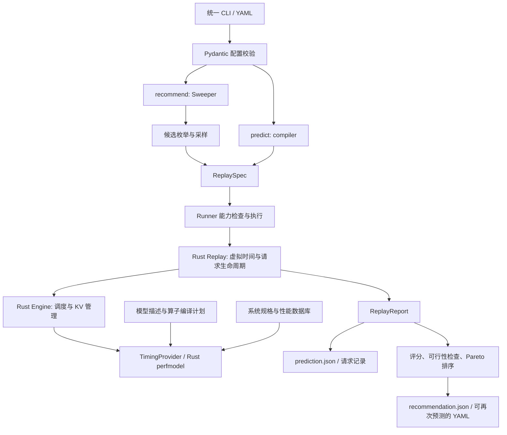

<!--
SPDX-FileCopyrightText: Copyright (c) 2026 NVIDIA CORPORATION & AFFILIATES. All rights reserved.
SPDX-License-Identifier: Apache-2.0
-->

# AISimulate 代码结构与参数扩展分析

本文基于当前工作区源码梳理，基线提交为 `920453e6a6cfb958eae2b2f725db9b767788b4c7`，梳理日期为 2026-09-20。项目元数据版本为 `0.12.0`；本文描述的是这份源码，不代表所有同版本已发布安装包。现有工作区包含尚未提交的文档与运行结果，本文对参数能力的判断以配置定义、转换代码和运行边界为依据。

## 1. 先回答：是否还能进一步优化？

**可以，而且在“支持更多参数、让已有参数能够参与搜索”方面，有明确且可实施的空间。** 主要问题不是没有底层能力，而是不同入口的能力覆盖不一致：

1. **旧 AIC 或底层 SDK 已经支持，统一 CLI 尚未开放。** 典型包括投机解码、上下文并行 CP、显式量化模式、部分计算内核选择。
2. **`predict` 能设置，`recommend` 尚不能设置或搜索。** 典型包括两种 prefill 调度间隔、CUDA Graph 显存预留、G3 缓存卸载。
3. **已有结果指标，但尚不能作为目标或约束。** 例如功耗信息已经进入结果链路，而成本预算、能耗目标、P99 SLA 尚未成为统一配置能力。
4. **已有基础机制，但应用场景组合仍有限制。** 例如主机卸载与 P/D 分离、多模态与动态流量、AgentX 与投机解码的组合。

如果只选第一批工作，建议先补齐 **调度/显存参数的预测与搜索一致性**，再接通 **投机解码、CP、量化配置**。这些都属于配置与场景覆盖扩展，不要求以提高预测准确度为目标。

后文的优先级是本次代码分析提出的建议，不是项目已承诺的开发计划。

## 2. 项目做什么

AISimulate 是 LLM 推理部署的离线模拟与配置搜索工具。用户提供模型、硬件、推理后端、并行方式和请求负载，工具输出延迟、吞吐、资源使用等指标，或搜索满足目标的部署配置。

需要区分三类工作：

| 工作 | 主要入口 | 回答的问题 |
|---|---|---|
| 单配置预测 | `aisimulate predict` | 给定部署和请求负载，会发生什么？ |
| 配置搜索 | `aisimulate recommend` | 在参数范围、GPU 预算和 SLA 下，哪些配置更合适？ |
| 兼容估算、实验与部署生成 | `aiconfigurator cli ...` | 执行原有 AIC 工作流，包括静态估算和生成启动文件 |

它通常不执行模型权重上的真实文本生成。请求的 token 长度、到达时间、缓存复用关系等驱动模拟；GPU 算子性能数据来自预先采集的数据库。**运行模拟**与**采集性能数据**是不同过程，后者需要相应硬件及后端环境。

## 3. 仓库结构

以下目录树只展示主要职责边界；构建产物、缓存及本地输出不作为源码模块列出。

```text
aisimulate/
├── Cargo.toml                         # Rust workspace
├── crates/
│   ├── core/
│   │   ├── src/
│   │   │   ├── engine/                # 调度、KV 管理、抢占、卸载、执行时序
│   │   │   ├── replay/                # 请求回放、虚拟时间、多 worker、指标
│   │   │   ├── perfmodel/             # 算子性能计算、数据库查询、内存估算
│   │   │   ├── python.rs              # Python 原生扩展绑定
│   │   │   └── lib.rs                 # Rust 公共 API
│   │   └── parity_tests/              # 性能模型对照与回归验证
│   └── tests/public-api/              # Rust 公共接口契约检查
├── python/aisimulate/
│   ├── pyproject.toml                 # Python 包、命令入口、Maturin 构建
│   ├── uv.lock
│   ├── src/
│   │   ├── aisimulate/                # 统一 CLI、配置、Replay 桥接、Sweeper
│   │   ├── aisimulate_core/           # 面向调用方的核心 SDK 门面
│   │   ├── aiconfigurator/            # 兼容 CLI、任务编排、旧搜索、Generator
│   │   └── aiconfigurator_core/
│   │       ├── sdk/                   # 模型描述、算子描述、编译与内存接口
│   │       ├── model_configs/         # 模型结构配置缓存
│   │       └── systems/               # 系统规格、性能表和来源元数据
│   ├── collector/                    # 性能数据采集、case、后端实现
│   ├── tests/                        # 应用、SDK、Generator 等测试
│   ├── tools/                        # 回归门禁、数据工具、示例与验证工具
│   ├── docs/                         # AIC/估算器/数据采集详细说明
│   └── .claude/rules/                 # 各模块开发约束
├── tests/                            # 统一 CLI、Runner、Sweeper、契约测试
├── scripts/                          # 构建、发布、文档及法律文件检查
├── examples/                         # CLI 和 Sweeper 示例
├── docs/                             # 统一 CLI、核心 API、架构与迁移说明
└── .github/                          # CI、代码归属配置等
```

### 3.1 四个 Python 命名空间为什么同时存在

| 命名空间 | 当前职责 | 阅读代码时的注意点 |
|---|---|---|
| `aisimulate` | 新的应用入口和模拟/搜索编排 | 扩展统一 YAML，优先从这里入手 |
| `aisimulate_core` | 对外核心 SDK 门面 | 多个模块转发到 `aiconfigurator_core`，并非另一套算法实现 |
| `aiconfigurator` | 旧命令、Task、搜索编排、部署文件生成 | `sdk` 下部分文件是真实编排，部分只是兼容别名 |
| `aiconfigurator_core` | 模型与算子描述、核心 SDK 和性能数据 | 追踪底层实现时，应跟进到这里及 Rust `perfmodel` |

例如，[旧 `sdk/config.py`](../python/aisimulate/src/aiconfigurator/sdk/config.py)通过别名指向[核心配置实现](../python/aisimulate/src/aiconfigurator_core/sdk/config.py)。不要把两个同名文件理解成两套独立配置系统。

[打包配置](../python/aisimulate/pyproject.toml)使用 Maturin 构建一个 `aisimulate` Python 分发包，将上述命名空间及原生扩展 `aisimulate._runtime` 一起交付；Rust 包名是 `aisimulate-core`。核心运行不要求安装 Dynamo，Dynamo 集成通过扩展入口接入。

### 3.2 Python 与 Rust 如何分工

Python 主要负责配置解析、模型结构构造、候选配置搜索、结果整理和部署文件生成。Rust 主要负责性能数值计算、调度器状态推进、KV 状态管理和离散事件回放。

当前 Python `operations/` 主要描述算子的参数、权重大小和数据视图，性能数值计算的权威实现位于 Rust。不能简单理解为“Python 算一套，再用 Rust 加速同样的一套”。依据是[算子职责说明](../python/aisimulate/src/aiconfigurator_core/sdk/operations/README.md)和[引擎编译实现](../python/aisimulate/src/aiconfigurator_core/sdk/engine.py)。

另外存在两个不同含义的 `EngineConfig`：

- [调度引擎配置](../crates/core/src/engine/config.rs)：描述队列、batch、KV、抢占、后端调度行为。
- [性能模型配置](../crates/core/src/perfmodel/config.rs)：描述模型身份、并行、精度、性能数据及编译计划。

新增一个参数时，先判断它改变哪一层。有些参数，例如投机解码和 CP，需要同时贯穿多层。

## 4. 主要执行链路



### 4.1 单配置预测：`predict`

1. [`main.py`](../python/aisimulate/src/aisimulate/main.py)读取 YAML 和 `--set` 覆盖项，分离核心配置与 adapter 配置。
2. [`config/cli.py`](../python/aisimulate/src/aisimulate/config/cli.py)、[`config/engine.py`](../python/aisimulate/src/aisimulate/config/engine.py)、[`config/traffic.py`](../python/aisimulate/src/aisimulate/config/traffic.py)完成类型、范围与组合约束校验。核心模型使用 `extra="forbid"`，未知字段会报错。
3. [`compiler.py::prediction_to_replay_spec`](../python/aisimulate/src/aisimulate/compiler.py)将公开配置转换成 `ReplaySpec`，包括 worker、负载和 SLA。
4. [`runner.py`](../python/aisimulate/src/aisimulate/runner.py)将角色配置转换为原生运行输入；需要时解析模型、估算 KV 容量并配置性能模型。
5. Rust [`replay/`](../crates/core/src/replay/)推进虚拟时间；[`engine/`](../crates/core/src/engine/)决定每轮调度哪些请求、消耗多少 KV；性能模型提供相应耗时。
6. [`output.py`](../python/aisimulate/src/aisimulate/output.py)写出 `prediction.json`，需要时写出 `requests.jsonl`；[`detail.py`](../python/aisimulate/src/aisimulate/detail.py)整理诊断明细。

普通 aggregated/P/D 走事件回放。AFD 和带独立 encoder 的 EPD 有专门的分析式计算/组合路径，不能假设所有模式都具有相同的逐请求时间线和输出能力。

### 4.2 配置搜索：`recommend`

1. [`recommend.py`](../python/aisimulate/src/aisimulate/recommend.py)把统一配置转成 `SmartSearchConfig`。
2. [`sweeper/parallel_enum.py`](../python/aisimulate/src/aisimulate/sweeper/parallel_enum.py)等模块构造合法并行配置；[`parallel_projection.py`](../python/aisimulate/src/aisimulate/sweeper/parallel_projection.py)将优化器提出的选择映射到合法配置。
3. [`sweeper/search_space.py`](../python/aisimulate/src/aisimulate/sweeper/search_space.py)和 [`sampler.py`](../python/aisimulate/src/aisimulate/sweeper/sampler.py)描述搜索空间并提供候选。
4. [`sweeper/deploy.py`](../python/aisimulate/src/aisimulate/sweeper/deploy.py)物化运行参数，[`search.py`](../python/aisimulate/src/aisimulate/sweeper/search.py)执行候选、缓存重复结果并处理超时和不可行项。
5. [`score.py`](../python/aisimulate/src/aisimulate/sweeper/score.py)计算目标值、检查 GPU 预算和可选 SLA，执行排序或 Pareto 筛选。
6. [`result.py`](../python/aisimulate/src/aisimulate/sweeper/result.py)保留结果、失败原因和来源信息；保存的候选 YAML 可以再次输入 `predict`。

**因此，给 `predict` 增加一个字段，并不会自动让 `recommend` 支持它。** 搜索空间、候选物化、结果保存和重新加载，都需要明确传递该字段。

### 4.3 兼容 AIC 与 Generator

[兼容入口](../python/aisimulate/src/aiconfigurator/main.py)继续提供 `default`、`estimate`、`recommend`、`exp`、`generate`、`support` 等流程。核心任务编排位于 [`Task`](../python/aisimulate/src/aiconfigurator/sdk/task_v2.py)，旧搜索与单点预测分别见 [`sweep.py`](../python/aisimulate/src/aiconfigurator/sdk/sweep.py)和 [`predict.py`](../python/aisimulate/src/aiconfigurator/sdk/predict.py)。

[`AnalyticPredictor`](../python/aisimulate/src/aiconfigurator/sdk/predictor.py)走分析式 worker 估算。它与统一 CLI 的动态请求回放不同，旧 `batch_size` 不能直接等同于新入口的并发数或 `max_sequences`。

[`generator/`](../python/aisimulate/src/aiconfigurator/generator/)负责请求归一化、配置/事实解析、规则与模板渲染、部署产物构建。主要入口包括 [`api.py`](../python/aisimulate/src/aiconfigurator/generator/api.py)和 [`pipeline.py`](../python/aisimulate/src/aiconfigurator/generator/pipeline.py)，后端模板位于 `config/backend_templates/`。

`recommendations/*.yaml` 是可以回放的模拟配置，不能自动等同于可直接部署的 Kubernetes 清单或后端启动命令。

### 4.4 模型、性能数据和 Collector

- [`sdk/models/`](../python/aisimulate/src/aiconfigurator_core/sdk/models/)将模型配置解释成结构和算子组合。
- [`sdk/config.py`](../python/aisimulate/src/aiconfigurator_core/sdk/config.py)中的 `ModelConfig` 描述并行、精度、CP、投机方案等；`RuntimeConfig` 描述 batch、token 长度、图像/视频等运行输入。
- [`sdk/engine.py`](../python/aisimulate/src/aiconfigurator_core/sdk/engine.py)把模型编译成序列化算子计划，交给 Rust 解释执行。这里的“编译”不是生成模型机器码。
- [`perfmodel/operators/`](../crates/core/src/perfmodel/operators/)与 [`perfmodel/perf_database/`](../crates/core/src/perfmodel/perf_database/)负责算子数值和性能数据读取。
- 当前性能表主要位于 `python/aisimulate/src/aiconfigurator_core/systems/data/<system>/<family>/<backend>/<version>/`，格式为 Parquet。
- [`collector/`](../python/aisimulate/collector/)根据 case 和后端实现采集数据；模型 case、基础算子 case、硬件能力约束、采集来源共同决定数据覆盖。

增加一个后端字符串或模型配置文件，并不等于该组合已完整支持：还要有模型/算子描述、调度语义、性能数据以及适用的运行契约。

## 5. 当前参数支持概览

本表按统一 CLI 的公开配置描述。底层 SDK 的能力可能更宽；“支持”也不代表所有模型、后端和拓扑可以任意组合。

| 参数类别 | 当前字段或能力 | 边界与扩展空间 |
|---|---|---|
| 模型、后端、版本 | `engine.model`、`backend`、`backend_version` | 后端包括 vLLM、SGLang、TRT-LLM；模型和版本在单次统一搜索中是固定值 |
| 部署模式 | `aggregated`、`disaggregated`、`afd` | AFD 有独立拓扑及负载约束，不能随意与其他模式混搜 |
| 硬件 | `engine.hardware`；P/D worker 可各自指定 `hardware` | 已有异构 P/D；每个角色的硬件目前是固定值，P/D 共享模型、后端及后端版本 |
| 并行 | `replicas`、`tensor`、`pipeline`、`attention_data`、`moe_tensor`、`moe_expert` | 已有 TP/PP/DP/EP 配置；统一入口缺 CP；PP 不代表完整流水线事件模拟 |
| batch 调度 | `scheduler.max_batched_tokens`、`max_sequences` | `predict` 与 `recommend` 均有对应配置/搜索能力 |
| prefill 调度节奏 | `prefill_schedule_interval`、`prefill_decode_interval` | 前者仅 vLLM，后者仅 SGLang；当前只出现在预测 schema |
| KV 基础配置 | `block_size`、`prefix_caching`、`bytes_per_token` | block size 可以搜索；prefix caching 目前是固定布尔值；开缓存不等于指定命中率 |
| KV 容量 | `capacity.type`、`memory_fraction`、`blocks` | 支持自动容量与固定 blocks；`memory_fraction` 可以搜索 |
| CUDA Graph 显存预留 | `capacity.cuda_graph_reserved_bytes` | 预测支持用户提供的非 KV 显存预留；推荐 schema 未包含 |
| 主机卸载 | `host_offload.num_host_blocks`、D2H/H2D 带宽 | 目前限 aggregated vLLM、attention DP=1、开启 prefix caching；推荐可固定配置，但不是容量/带宽搜索域 |
| G3 卸载 | `g3_offload` 的作用域、容量、首字节延迟、读写带宽 | 预测支持且依赖 host offload；推荐 schema 未包含 |
| P/D KV 传输 | `kv_transfer.bytes_per_token`、`bandwidth_gb_per_second`、`timing_mode` | 支持请求级传输；不等于完整网络拓扑、共享链路争用或 KV 布局转换模拟 |
| 单轮合成流量 | `input_tokens`、`output_tokens` | 统一入口为固定整数；长度分布与长度场景对比仍可扩展 |
| 多轮合成流量 | `synthetic-session`、turns、共享前缀、分组、轮间延迟 | 已有会话能力，不能把“支持多轮”作为从零新增项 |
| 到达与负载 | concurrency、constant rate、Poisson、trace timestamps | 推荐还支持 KV 容量比例负载；不同 source 的字段组合受校验约束 |
| Trace / AgentX | Mooncake、delta、Dynamo、Weka 等，及 `agentic_lanes` | AgentX 内置 runner 当前限定 agg、vLLM/SGLang，不支持与 host offload/投机解码组合 |
| 图像与 encoder | `traffic.source.images`、`workers.encoder` | 已支持分析式 EPD；图像尺寸固定、并发固定，不是完整 encoder 事件回放 |
| SLA | `ttft_ms`、`itl_ms`、`e2e_ms` | E2E 与 TTFT/ITL 形式互斥；strict SLA 检查均值，未开放 P95/P99 或租户级约束 |
| 优化目标 | throughput、per-GPU/per-user throughput、goodput、goodput/GPU、TTFT、E2E、Pareto | 尚无公开成本目标、能耗目标、费用预算 |
| 优化器 | Bayesian/random、trial 数、进程并行度、超时、seed | 采样式搜索，不保证穷举全部合法配置 |
| Router / Planner | 按 stack 加载的 adapter 配置 | 内置 engine 使用轮转放置且无自动扩缩容；Dynamo 策略属于外部集成 |

主要依据：[engine 配置](../python/aisimulate/src/aisimulate/config/engine.py)、[traffic 配置](../python/aisimulate/src/aisimulate/config/traffic.py)、[目标与 SLA](../python/aisimulate/src/aisimulate/config/common.py)、[Runner 能力声明](../python/aisimulate/src/aisimulate/runner.py)、[迁移边界](cli/migrate-from-aiconfigurator.md)。

### 5.1 几个容易误读的参数

- **并发数不等于 batch size。** 并发描述在途请求，调度器根据 token 预算、KV 空间和队列情况形成每轮 batch。
- **`replicas` 不等于 `attention_data`。** 前者复制 worker；后者是一个 worker 内的 attention DP 组织。
- **MoE EP 不是在 TP/DP 的 GPU 数上再乘一次。** 普通统一 worker 的 GPU 数按 `replicas × tensor × pipeline × attention_data` 计算，MoE TP/EP 要满足相应布局约束。CP 扩展后也必须同步更新资源计算。
- **`hardware: auto` 不表示遍历所有 GPU SKU。** 当前要求 `optimization.hardware` 给出一个具体硬件；P/D 的固定异构覆盖是另一个机制。
- **`kv_cache.bytes_per_token` 不等于 KV 量化精度。** 它描述内存/传输字节量；真正的 dtype 还涉及模型、算子选择和性能数据。
- **`cuda_graph_reserved_bytes` 只表达显存占用。** 它不是 CUDA Graph 开关，也不自动模拟图捕获策略对执行耗时的影响。
- **`strict_sla` 不是 P99 SLA。** [`aggregate_sla_violations`](../python/aisimulate/src/aisimulate/sweeper/score.py)检查的是均值；其中 `itl_ms` 对应的 aggregate 指标为 mean TPOT。逐请求 goodput 是另一种判定语义。

## 6. 建议扩展哪些参数

以下所有“建议字段”均为设计建议，**不是当前可直接写入 YAML 的已实现字段**。工作量用相对等级表示，不是工期承诺。

### 6.1 第一优先级：补齐已有能力的入口与搜索

| 方向 | 现有代码证据 | 建议扩展 | 相对工作量 |
|---|---|---|---|
| 调度间隔进入推荐 | `SchedulerPredictionConfig` 有两个 interval；`SchedulerRecommendationConfig` 只有 batch/token 上限 | 将 interval 同时支持固定值及 `choices/range`，按后端校验 | 小到中 |
| CUDA Graph 显存预留进入推荐 | `KvCapacityPredictionConfig` 有预留字段，推荐版本缺失 | 先支持固定透传，再按需要支持预留量候选 | 小到中 |
| G3 和 host offload 搜索 | G3 仅在预测 schema；host offload 参数固定 | G3 配置透传；按合法拓扑搜索容量、带宽、作用域等 | 中；跨后端/拓扑支持更大 |
| 投机解码统一配置 | AIC 有多种方案；原生调度/Runner 有 MTP 深度、接受率和 seed | 建议 `engine.speculative`，分阶段开放 scheme、draft 长度、draft model、接受率及随机种子 | 中到大 |
| CP 统一配置 | `ModelConfig.cp_size/cp_style` 与 Rust `ParallelMapping.cp_size` 已存在 | 建议 `parallelism.context`，接通预测、合法布局枚举、容量和搜索 | 中到大 |
| 显式量化配置 | `ModelConfig` 已有 GEMM/MoE/KV/FMHA/通信精度 | 建议 `engine.quantization`，先开放固定值，再考虑合法精度组合搜索 | 中 |

调度、缓存差异可直接对照[统一 engine schema](../python/aisimulate/src/aisimulate/config/engine.py)。CP 和量化的底层依据见[核心配置](../python/aisimulate/src/aiconfigurator_core/sdk/config.py)及 [Rust 性能模型配置](../crates/core/src/perfmodel/config.rs)。

**投机解码需要特别区分“计算成本”和“生成进度”。** 当前 [speculation 包](../python/aisimulate/src/aiconfigurator_core/sdk/speculation/README.md)包含 `ngram`、`eagle3`、`dflash`、`dspark`、`draft_model`、`mtp`。性能模型估算 draft/verify 的计算成本，而接受了多少 token 决定一次迭代推进多少输出。

原生回放已存在 `aic_nextn`、`aic_nextn_accept_rates`、`aic_mtp_seed`；Sweeper 的 `SearchSpace` 也有固定 `aic_nextn`，但统一 `EnginePredictionConfig/EngineRecommendationConfig` 没有相应公开配置。底层 MTP 通道不表示其他五种方案已完整支持事件回放。

建议先贯通已有 MTP 语义，再逐项接入其他方案。不同方案与 FPM、P/D、EPD、AgentX 的限制应保留明确校验。接受率宜作为用户提供的场景假设；draft 长度才适合作为部署选择参与搜索，不能让优化器通过“提高假设接受率”获得虚假的最优配置。

**CP 也不是简单增加一个整数。** 它改变序列切分、GPU 数、MoE 布局匹配、通信及 KV 计算。底层某模型支持 CP，不能直接推导出所有后端的回放都已支持。PP 已有字段，但若需要流水线 stage、microbatch、bubble 的运行语义，属于额外的模拟功能扩展。

### 6.2 第二优先级：开放后端调度策略与计算内核选择

[Rust 调度配置](../crates/core/src/engine/config.rs)比统一 YAML 更丰富，已经包含：

- `enable_chunked_prefill`。
- `preemption_mode`：当前有 FIFO/LIFO。
- SGLang 的 `schedule_policy`：FIFO/LPM。
- SGLang 的 `max_prefill_tokens`、`chunked_prefill_size`、`clip_max_new_tokens`、`schedule_conservativeness`。
- TRT-LLM 的显式 capacity policy；当前实现只有 `GuaranteedNoEvict`。

可以优先将已有实现开放到统一配置及搜索，建议采用后端专属子配置，避免同名参数在不同后端下暗中改变语义。TRT-LLM 新增其他 capacity policy 则需要真正增加调度实现，不能仅扩大枚举取值。

计算内核方面，底层 `ModelConfig` 已有 `attention_backend`、`moe_backend`。[参数分组文件](../python/aisimulate/src/aisimulate/config_adapter/config/server_knob_groups.yaml)同时明确列出了 Replay 尚不能表达的一组 kernel selector，例如 attention/GEMM/MoE kernel source。这个文件只是分类和边界说明，本身不会让参数生效。

建议先开放底层已存在且性能数据可覆盖的 selector，再考虑更细粒度内核来源。校验至少要覆盖后端版本、设备能力、模型结构、dtype 和性能表，防止配置指定了某个内核但实际仍使用默认路径。

### 6.3 第二优先级：更丰富的负载和 SLA

**负载输入扩展：** 建议支持输入/输出长度分布、长短请求混合比例、分段到达率、突发持续时间及分布随机种子。当前统一 `SyntheticSource` 的长度是固定整数；下层 Runner 已有部分随机长度处理，已有 trace 路径也能携带真实变化，适合复用这些机制。

多轮 session、共享前缀和 AgentX 已有基础，不应重复建设。更有价值的是把这些能力与负载分布、请求截止时间、取消行为及不同请求类别结合起来。

**SLA 扩展：** 建议提供明确的统计口径，例如 `metric=ttft`、`statistic=p99`、`threshold_ms`，并支持最小达标比例、请求类别级 SLA。需要同时更新 schema、指标汇总与 Sweeper 的可行性判定；报告能显示 P99，不代表搜索已经能用 P99 约束候选。

**场景对比与部署优化应分开。** 例如 ISL/OSL 或到达率代表业务需求时，不能为了让吞吐更好而自动把需求降低。可以增加“在多个负载场景下评估同一个部署”的输入，把部署参数作为决策变量，把业务负载作为固定条件或压力测试场景。

相关代码：[traffic schema](../python/aisimulate/src/aisimulate/config/traffic.py)、[traffic 转换](../python/aisimulate/src/aisimulate/traffic.py)、[原生负载生成](../crates/core/src/replay/loadgen/)、[评分与 SLA](../python/aisimulate/src/aisimulate/sweeper/score.py)。

### 6.4 第二优先级：成本、能耗与资源预算

当前 [`OptimizationConfig`](../python/aisimulate/src/aisimulate/config/common.py)没有价格、成本或能耗目标。可以考虑：

| 建议输入/目标 | 用途 | 所需语义 |
|---|---|---|
| 每种硬件的 `price_per_gpu_hour` | 异构 GPU 的成本比较 | 用户提供价格、计价单位及适用范围，不能只比较 GPU 个数 |
| `max_cost` / `cost_per_million_tokens` | 固定业务需求下的费用约束和排名 | 使用按硬件/角色累计的 GPU-hours 与计费模型 |
| `max_energy` / `energy_per_output_token` | 能耗预算与能效比较 | 需要累积 GPU 数、运行时间、活动/空闲功率等相应证据 |
| 每个角色/节点的资源上限 | 表达真实部署库存 | 区分 GPU 总数、单机容量、角色配额及 placement 限制 |

**项目已经有功耗结果链路。** [`power.py`](../python/aisimulate/src/aisimulate/power.py)、[原生报告](../crates/core/src/replay/report.rs)、[候选结果](../python/aisimulate/src/aisimulate/sweeper/result.py)已经处理 `power_w` 和 `power_coverage`，缺失或覆盖不足时使用不可用语义。

这里的 `power_w` 是活动计算期间、按延迟加权的每 GPU 建模功率，不能直接当作机房功率或总能耗。新增成本/能耗目标必须定义清楚累计口径。[功耗说明](power-model.md)中仍有“后续接入”的历史措辞，判断实现状态应以当前源码为准。

### 6.5 中长期：扩展场景组合与部署拓扑

| 方向 | 当前基础/限制 | 可以新增的参数或语义 |
|---|---|---|
| 更完整的异构 P/D | 已支持 P/D 不同硬件；仍共用模型、后端与版本 | 角色级 backend/version、硬件候选集；需处理 KV 格式与传输兼容 |
| 网络与放置 | 已有 KV 传输带宽、AFD 通信参数；P/D 不模拟完整争用与布局转换 | 节点/机架位置、链路延迟、共享带宽、NIC 数量、传输并发上限 |
| offload 组合 | 主机卸载目前限 agg vLLM、DP=1；G3 依赖它 | 与 DP、P/D、其他后端组合，需实现 KV 所有权和调度时序 |
| 多模态 | 已有固定图片、分析式 encoder pool；核心 SDK 有视频字段 | 统一视频输入、可变图片数量/尺寸、encoder queue、embedding transfer |
| AgentX 组合 | 已有 graph/session 回放；内置 runner 显式禁止部分组合 | 与投机解码、offload、P/D 的合法组合，以及超时/取消后的资源释放 |
| 多租户与多模型/LoRA | 当前统一 engine 以单模型为中心，未见端到端公开配置；底层 trace 已有 priority 元数据 | tenant、adapter rank/数量、切换成本、配额、公平性、分租户指标 |

这些方向大多需要扩展运行模型，工作量高于 schema 透传。已有 priority 字段不等于已实现完整租户公平调度；已有取消接口也不等于所有截止时间策略已具备。

多模态尤其要避免把“已有 EPD”写成“完整 E/P/D 事件模拟”。目前 [EPD](sweeper/epd.md)是受约束的分析式组合，拒绝 trace、session、动态到达等若干输入，并不提供 encoder 排队或 embedding 传输时间线。

### 6.6 哪些参数不宜直接作为第一批目标

`temperature`、`top_p`、`top_k`、文本 stop 条件等主要决定实际 token 采样和输出内容。AISimulate 并不执行完整文本生成，仅允许 YAML 接受这些字段，未必会影响模拟结果。

如果目标是评估它们对部署的影响，更合理的入口是它们所对应的可观测工作负载：输出长度分布、提前结束行为、投机接受率、采样/约束解码额外开销等。只有定义了具体消费路径和行为，才应声明支持某个生成参数。

## 7. 新参数应该改哪些代码

以“让已有 prefill 调度间隔参加推荐搜索”为例，建议按照下面的链路实施：

| 环节 | 主要位置 | 必须解决的问题 |
|---|---|---|
| 公开配置 | `aisimulate/config/engine.py` | 预测固定值与推荐 domain 的定义，后端和数值范围校验 |
| 预测编译 | `aisimulate/compiler.py` | 公开字段是否正确映射到底层参数 |
| 推荐转换 | `aisimulate/recommend.py` | 输入 domain 转成搜索配置，候选保存时保留选中的值 |
| 搜索空间 | `aisimulate/sweeper/config.py`、`search_space.py`、`sample.py` | 参数能否参与采样，默认值、条件域、候选身份是否正确 |
| 部署物化 | `aisimulate/sweeper/deploy.py` | 每个候选是否传入真实运行参数，而非只写在 metadata 中 |
| Runner 与协议 | `aisimulate/runner.py`、`sweeper/replay.py` | 能力检查、角色映射、原生序列化是否覆盖 |
| 运行消费 | `crates/core/src/engine/` 或 `perfmodel/` | 是否真正改变调度、KV、算子或资源计算；已有实现尽量复用 |
| 输出闭环 | `recommend.py`、`sweeper/result.py`、`output.py` | 推荐 YAML 重新用于 predict 后，参数语义是否一致 |
| 部署导出（如适用） | `aiconfigurator/generator/` | 后端 flag、版本模板是否能表达同一配置 |

不是每次都要修改表中所有文件；应沿数据流确认哪些环节已有支持。特别注意：

1. **禁止静默忽略。** 不适用的 backend/模型/拓扑组合应给出可定位错误。
2. **默认值保持兼容。** 旧输入不应因为新增字段而暗中改变行为。
3. **保持候选身份完整。** 会改变执行结果的字段必须进入候选快照和去重依据。
4. **定义单位与角色。** 字节与 token、GB/s 与其他带宽单位、per-rank 与 per-worker、prefill 与 decode 不能混用。
5. **把效果和持久化一起验证。** 验证的不只是 schema 接受字段，还应包括输出行为以及“推荐 → 保存 → 再预测”的一致性。

参数相关测试可从[统一 CLI 配置测试](../tests/test_cli_config.py)、[Runner 测试](../tests/test_runner.py)、[统一 CLI 测试](../tests/test_unified_cli.py)、[Sweeper 测试](../tests/sweeper/)及 Rust scheduler 测试中选择。涉及模型算子或序列化协议时，还要覆盖引擎计划兼容性和对应回归门禁。

修改 Generator 前必须阅读[Generator 开发规则](../python/aisimulate/.claude/rules/generator-development.md)；修改 Collector 前必须阅读[分层权限](../python/aisimulate/.claude/rules/collector/layer_permissions.md)和[失败处理](../python/aisimulate/.claude/rules/collector/failure_handling.md)，case YAML 还需遵守[case 编写规则](../python/aisimulate/.claude/rules/collector/case_authoring.md)。这些是后续实施约束，本次只新增分析文档。

## 8. 推荐实施顺序与验收标准

| 阶段 | 建议交付 | 验收标准 |
|---|---|---|
| 第一阶段：入口一致性 | prefill interval、显存预留透传；G3 配置进入推荐 | 预测和推荐均接受合法固定值；保存的候选能完整还原配置 |
| 第二阶段：已有能力贯通 | MTP、显式量化、限定支持组合下的 CP；已有调度策略 | 字段确实到达 runtime；资源/吞吐/时序变化符合语义；非法组合明确拒绝 |
| 第三阶段：搜索与业务约束 | 上述参数的条件搜索域、P99 SLA、成本预算、负载分布 | 可行性判定使用指定口径；搜索不会通过改变业务假设“优化”结果 |
| 第四阶段：新场景组合 | 多模态事件回放、扩展 offload、跨后端 P/D、多租户 | 新生命周期、资源归属、指标口径和输出重放均有契约验证 |

对于当前项目，“优化其他参数支持”最值得先做的是一项完整的端到端能力：**用户能配置、优化器能选择、运行时会消费、结果能解释、保存后可复现**。仅扩展命令行参数表或允许任意后端参数透传，都不能独立满足这个目标。

## 9. 阅读与验证范围

建议按以下顺序继续阅读：

1. [统一 CLI 用户指南](cli/user-guide.md)与[旧 AIC 迁移边界](cli/migrate-from-aiconfigurator.md)：明确用户入口和支持范围。
2. [`config/`](../python/aisimulate/src/aisimulate/config/)、[`compiler.py`](../python/aisimulate/src/aisimulate/compiler.py)、[`recommend.py`](../python/aisimulate/src/aisimulate/recommend.py)：理解参数如何进入运行和搜索。
3. [`Runner`](../python/aisimulate/src/aisimulate/runner.py)与 [Replay 架构](../crates/core/src/replay/README.md)：理解请求、worker 和虚拟时间。
4. [核心 SDK API](core-api.md)、[模型描述](../python/aisimulate/src/aiconfigurator_core/sdk/models/)、[Rust 性能模型](../crates/core/src/perfmodel/)：理解每一步的成本来源。
5. [Sweeper 架构](sweeper/architecture.md)与[评分实现](../python/aisimulate/src/aisimulate/sweeper/score.py)：理解候选、目标和约束。

本次为源码与结构审阅，不是模型/硬件支持矩阵认证，也未执行 GPU 性能实验。判断依据以当前代码为主，尤其对旧文档中的迁移中状态进行了源码交叉核对。文档中的新增字段均为提案，不构成已实现功能声明。

已离线检查本文本地链接、代码块闭合及尾随空白，并用 Python AST 核对上述预测/推荐配置字段差异。当前环境缺少 `markdown-it-py`，仓库标准 Markdown 链接检查及其单元测试未能运行；本次离线检查仅覆盖本文，不替代完整仓库检查或运行时功能测试。
